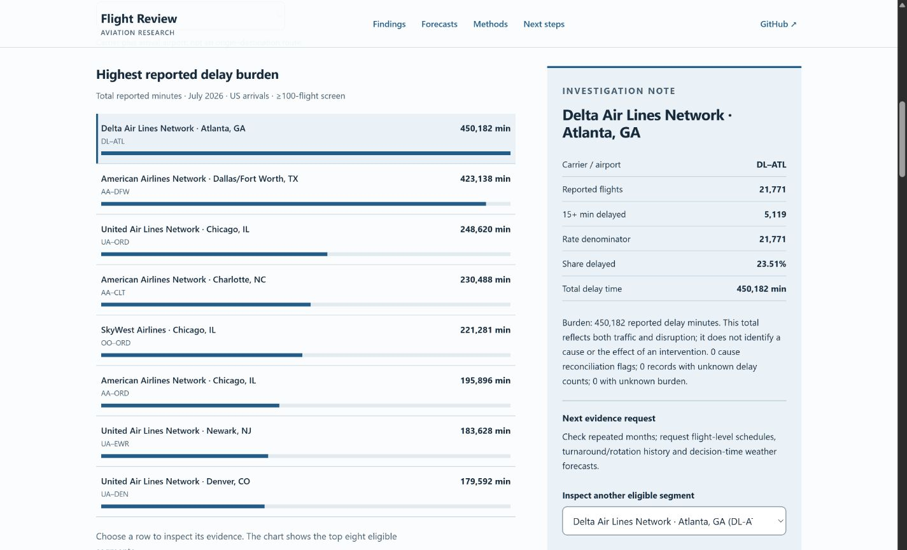

# Aviation decision support

Which airline-airport segments deserve further investigation, why, and what additional evidence would support an operational decision?

This independent proof of concept is developed with AI assistance. I review and learn the implementation, validate analytical claims, and document decisions and remaining limitations. It is a work in progress and is not affiliated with NABLA Mobility.

This disclosure describes the process, not completed personal review of every artifact. See [AI contributions and human review](docs/contributions.md). No live customer, operational deployment or savings are claimed.

## Interactive research story

[Explore the live study](https://mohammedumarasif.github.io/aviation-decision-support/). Flight Review presents the question, sources, measured findings and next evidence requests as a static interactive case study. Explore delay time, share delayed and traffic; compare measured review queues at four capacities; inspect baseline error and interval coverage; export a findings brief. The monthly arrival study and historical departure experiment remain separate. [Presentation validation](docs/UI_VALIDATION.md) records observed desktop/mobile checks and the successful public release.



Public assets are reviewed derived evidence only. `site/manifest.json` records canonical text hashes and generating code. To reproduce additional exports after running both analyses:

```powershell
uv run python scripts/export_public.py
uv run python -m http.server 8765 --directory site
```

## Findings

The July 2026 BTS file contains **1,806 monthly carrier-airport records covering 697,754 reported flights**. One missing count leaves 697,753 flights in the rate denominator: **27.21%** delayed arrivals. Nineteen distinct records fail both cause-count and cause-minute tolerances. Delta–Atlanta leads reported delay burden at 450,182 minutes. A rate ranking gives a different priority.

The separate NYC 2013 experiment uses 336,776 flight records, excluding 8,255 unknown departure-delay outcomes. On a 54,145-flight chronological test, the simple median baseline has **16.25 minutes MAE**, versus **20.64** for a random forest. At 20 reviews per day the forest catches 239 severe delays with 981 false alerts. Nominal 90% conformal coverage is **85.4%**, falling to **80.6% in December**. These results do not support live adoption.

Read the [stakeholder findings](reports/stakeholder.md), [monthly report](reports/report.md) and [forecast report](reports/forecast.md).

## Local demonstration

Install [uv](https://github.com/astral-sh/uv), then run from the repository root:

```powershell
uv sync --locked --python 3.12
uv run python scripts/demo.py
uv run python -m pytest -q
uv run ruff check .
uv run ruff format --check .
uv run ty check
```

The offline demo generates **synthetic** data and writes `reports/demo/report.md`. It demonstrates the workflow, not observed airline evidence.

Reproduce the flight research with network access (approximately a few minutes):

```powershell
uv run python scripts/download_flights.py
uv run python flight_research.py data/raw/flights.csv
```

For BTS, follow [data acquisition instructions](docs/data.md), then run:

```powershell
uv run python aviation_audit.py data/raw/Airline_Delay_Cause.csv
```

With Docker running:

```powershell
docker build -t aviation-demo .
docker run --rm aviation-demo
```

GitHub Actions checks code, runs the synthetic demo, builds/runs Docker and separately reproduces the full flight experiment. See [validation evidence](docs/validation.md) for observed results and limits.

## Status

| Component | Status | Evidence and limits |
|---|---|---|
| Monthly audit and three rankings | Implemented; execution validated | Hashes, missing-field counts, flagged keys, exclusions and reports |
| Median and random forest | Experimental; retrospectively evaluated | Chronological partitions, frozen features, MAE and review queue |
| Split-conformal intervals | Experimental; undercoverage observed | No adaptive method or temporal coverage guarantee |
| Stakeholder report | Implemented | Markdown findings, recommendation and evidence requests |
| Interactive research page | Published; desktop/mobile verified | Complete aggregate exports, measured capacity grid, shared state and downloadable brief; [live study](https://mohammedumarasif.github.io/aviation-decision-support/) |
| Docker and CI | Implemented | Validation record distinguishes local daemon limits from CI evidence |
| Personal learning and review | In progress | Rate-versus-volume and single prediction-error exercises completed; broader review pending |
| Customer validation, service effects, CDK/TypeScript | Planned | No production or infrastructure claims |

## Skills demonstrated

| Capability | Completed artifact | Scope |
|---|---|---|
| Customer problem framing | [Stakeholder report](reports/stakeholder.md) | Hypothetical analyst and explicit decision; no customer interview |
| Business challenges and opportunities | [Monthly report](reports/report.md) | Burden, rate and traffic comparison |
| Data validation and feasibility | [Audit](aviation_audit.py), [tests](tests/test_audit.py) | Missing values, duplicate keys, invalid values and reconciliation |
| Quantitative evaluation | [Forecast](flight_research.py), [results](reports/forecast.json) | Baselines, alert burden and interval coverage; not service effects |
| Automated analytical pipelines | [CI](.github/workflows/checks.yml), [Dockerfile](Dockerfile) | Locked dependencies and executable checks |
| Stakeholder recommendations | [Findings](reports/stakeholder.md) | Next evidence requests and explicit limits |
| Responsible AI assistance and learning | [Contributions](docs/contributions.md), [learning](docs/learning.md) | AI implementation disclosed; personal review recorded narrowly |

The [current NABLA role](https://app.zookeep.com/career/nabla-mobility/analytics-engineer-9894) connects customer analysis and recommendations with BizDev and Science Team decisions. This prototype can support a discussion of data gaps, trade-offs and feasibility. It does not establish job eligibility or airline production suitability. [Operational Forecaster](https://www.nabla-mobility.com/operational-forecaster) is context, not a product reproduced here.

## Review guide

- [Architecture](docs/architecture.md), [dictionary and provenance](docs/data.md)
- [Methodology and limitations](docs/methodology.md), [research and tools](docs/research.md)
- [Decision log](docs/decisions.md), [contributions](docs/contributions.md)
- [CV bullets and interview draft](docs/career.md), [learning exercises](docs/learning.md)

Code is MIT licensed. Data licenses are separate. Raw files, the CV, private documents and credentials are excluded from Git.
