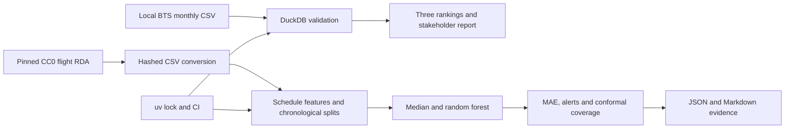

# Architecture

The original audit command and `analyse` entry point remain supported. Raw text ingestion is followed by explicit numeric casting, avoiding unsafe inference for empty or infinite cells. Validation precedes output. DuckDB runs in memory.

`download_flights.py` captures provenance. `flight_research.py` separates preparation, splitting, interval estimation, queue evaluation and model orchestration. A feature allowlist excludes post-event columns. `verify_forecast.py` checks reproduction within floating-point tolerance.

Markdown/JSON reports keep review lightweight without a server. Docker runs the offline synthetic demo. CI checks code/container execution and separately reproduces the public flight research. Raw data and personal documents are excluded. CDK/TypeScript remains a later learning exercise.
